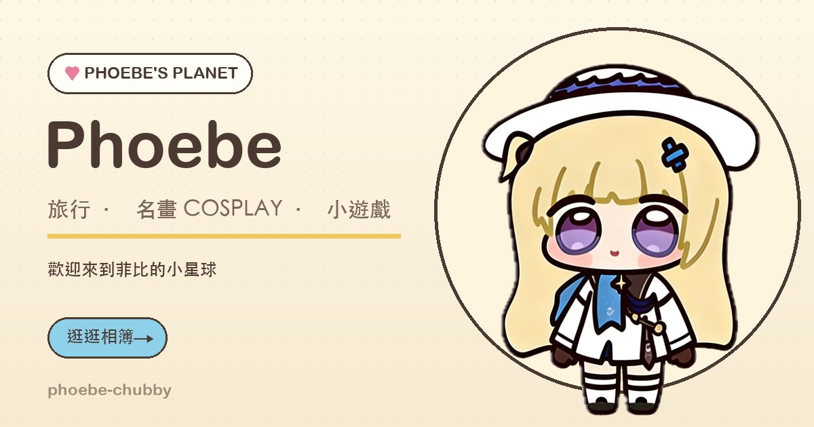

# Phoebe 小星球 · 菲比的相簿與遊戲小屋

給 **Phoebe（菲比）** 的可愛風專屬網站：一座古典畫廊風的相簿、世界名畫 cosplay 照片，還有 7 款可以直接玩的網頁小遊戲。
純靜態網站（HTML + CSS + 原生 JavaScript），沒有建置流程、沒有後端，**可以直接放上 GitHub Pages**。



---

## 這個網站有什麼

- **首頁**：角色主視覺、角色檔案、精選相簿、遊戲專區、小屋日記。
- **古典畫廊（相簿）**：分成兩個展區——**I. 跟著菲比賞名畫**（名畫 cosplay 12 件，深綠展牆＋金色畫框）與 **II. 跟著菲比去旅行**（五國 × 四張：日本、法國、澳洲各 4 張已加入；中國、挪威準備中；淺色旅行手帳＋五國各自配色）。燈箱會依作品切換古典畫框或明信片樣式，可點開放大、左右切換（支援鍵盤與手機滑動）。
- **遊戲專區**：7 款小遊戲，手機可玩，最高分自動存在瀏覽器裡。
- **關於菲比**：角色小檔案、小故事、網站製作方式、版權說明。
- **語言切換**：繁體中文、简体中文、English、日本語、한국어；頁首可切換，選擇會存在瀏覽器，套用到全站與遊戲頁。
- **404 頁**：迷路時也有可愛的畫面。
- 全部頁面都是響應式，支援減少動效（`prefers-reduced-motion`）。

### 7 款小遊戲

| 遊戲 | 頁面 | 類型 | 最高分格式 |
| --- | --- | --- | --- |
| 星星接接樂 | `games/catch-stars.html` | 反應 | 分數 |
| 記憶翻翻牌 | `games/memory.html` | 記憶 | 最少步數 |
| 打地鼠 | `games/whack.html` | 反應 | 分數 |
| 菲比拼圖 | `games/puzzle.html` | 益智 | 最少步數 |
| 小菲比跳跳 | `games/jumper.html` | 動作 | 分數 |
| 數字合合樂（2048） | `games/2048.html` | 益智 | 分數 |
| 星星打磚塊 | `games/breakout.html` | 動作 | 分數 |

---

## 本機預覽

在專案資料夾開啟一個靜態伺服器：

```bash
cd phoebe-chubby
python3 -m http.server 8000
```

然後打開 <http://localhost:8000>。

> 建議用伺服器預覽，而不是直接雙擊 HTML（`file://`）。所有頁面都是相對路徑，用 GitHub Pages 或任何靜態伺服器都可以。
> Windows 可以用 `py -m http.server 8000`。

---

## 專案結構

```text
phoebe-chubby/
├── index.html                # 首頁
├── gallery.html              # 相簿
├── games.html                # 遊戲專區
├── about.html                # 關於菲比
├── 404.html                  # GitHub Pages 404
├── favicon.ico
├── .nojekyll                 # 告訴 GitHub Pages 不要跑 Jekyll
├── .gitignore
├── assets/
│   ├── css/
│   │   ├── style.css         # 全站樣式（設計變數、版面、元件）
│   │   └── games.css         # 遊戲頁與遊戲棋盤共用樣式
│   ├── js/
│   │   ├── site.js           # 導覽、進場動畫、最高分、小幫手
│   │   ├── i18n.js           # 語言切換器與翻譯套用邏輯
│   │   ├── i18n/             # 繁中以外的語言檔（zh-Hans / en / ja / ko）
│   │   ├── gallery-data.js   # ★ 相簿資料（要加照片改這裡）
│   │   └── gallery.js        # 古典畫廊兩展區、燈箱
│   ├── img/
│   │   ├── phoebe/           # 角色原圖、去背圖、方形圖、頭像
│   │   ├── gallery/          # 相簿示範插圖
│   │   ├── og-cover.jpg      # 分享預覽圖
│   │   └── favicon*.png
│   └── favicon.ico
├── games/
│   ├── catch-stars.html      # 每款遊戲 = 一個 HTML + 一支 JS
│   ├── memory.html
│   ├── whack.html
│   ├── puzzle.html
│   ├── jumper.html
│   ├── 2048.html
│   ├── breakout.html
│   └── js/
│       ├── catch-stars.js
│       ├── memory.js
│       ├── whack.js
│       ├── puzzle.js
│       ├── jumper.js
│       ├── 2048.js
│       └── breakout.js
├── photos/                   # 你的真實照片
│   ├── travel/               # japan/french/australia-01..04.jpg（原 PNG 已忽略）＋ 中國/挪威素材
│   ├── cosplay/              # 12 件名畫 cosplay（網站用 JPEG）＋ thumbs/ 縮圖
│   └── daily/                # 預留（目前沒有日常作品）
└── tools/
    ├── make_placeholders.py  # 產生 15 張示範插圖（可重跑）
    ├── contact_sheet.jpg     # 15 張示範插圖的檢查表
    ├── build_report.txt      # 產圖報告（尺寸、角色位置）
    ├── i18n-source.json      # 全站翻譯來源字串（463 條）
    └── browser-check.mjs     # 開發用：headless Chrome 截圖與錯誤檢查
```

---

## 相簿結構與換照片

### 第二展區：五國 × 四張

| 國家 | 目前照片 | 檔案 |
| --- | --- | --- |
| 日本 | 4 / 4 | `photos/travel/japan-01.jpg`～`japan-04.jpg` |
| 法國 | 4 / 4 | `photos/travel/french-01.jpg`～`french-04.jpg` |
| 中國 | 0 / 4（準備中） | `photos/travel/china-01.jpg`～`china-04.jpg` |
| 澳洲 | 4 / 4 | `photos/travel/australia-01.jpg`～`australia-04.jpg` |
| 挪威 | 0 / 4（準備中） | `photos/travel/norway-01.jpg`～`norway-04.jpg` |

- 每張照片用 **1:1、1200×1200** 的 JPEG；原始 PNG 放 `photos/travel/` 會被 `.gitignore` 忽略。
- 把四張圖放進 `photos/travel/` 後，打開 `assets/js/gallery-data.js`，在 `countries` 裡找到對應國家，把照片塞進 `photos` 陣列：

```js
{
  src: "photos/travel/french-01.jpg",
  title: "巴黎・塞納河",
  meta: "巴黎 · 塞納河畔 · 秋天",
  category: "travel",
  alt: "Phoebe 在巴黎塞納河畔"
}
```

- 四張都填滿後，該國那一列會自動從「照片準備中」變成照片卡；不滿四張時，剩下的位置仍會顯示準備中。
- 新標題、地點與 alt 需要補進 `assets/js/i18n/*.js` 與 `tools/i18n-source.json`，否則切換語言時會留在中文。

### 第一展區：名畫 cosplay

`assets/js/gallery-data.js` 的 `items` 陣列只放 `category: "cosplay"` 的作品；照片放 `photos/cosplay/`，卡片使用 `thumb` 縮圖、直式用 `portrait: true`。首頁「最近的照片」仍是寫在 `index.html` 的四張固定精選。

### 首頁的「最近的照片」

首頁那 4 張是直接寫在 `index.html` 裡的固定內容，目前是新加入的 4 件名畫 cosplay（使用 `photos/cosplay/thumbs/` 縮圖、直式卡片）。
想換首頁精選照片，直接改這四個 `` 與標題就好。

---

## 換掉角色圖

| 檔案 | 用途 |
| --- | --- |
| `assets/img/phoebe/phoebe-front.jpg` | 首頁角色檔案、關於頁用的原圖（白底） |
| `assets/img/phoebe/phoebe.png` | 首頁主視覺用的去背 PNG（透明背景） |
| `assets/img/phoebe/phoebe-square.jpg` | 菲比拼圖用的方形圖（1100×1100） |
| `assets/img/phoebe/avatar.png` | 頁首、頁尾、小幫手、favicon 用的圓形頭像 |
| `assets/img/og-cover.jpg` | 分享到社群網站時的預覽圖（1200×630） |

換圖時建議保留同樣的檔名與大致比例，版面就不會跑掉。
去背可以用任何你習慣的工具（Photoshop、remove.bg、Pillow…），輸出透明 PNG 覆蓋 `phoebe.png` 即可。

---

## 修改文案與角色設定

- **角色檔案數字**：`index.html` 的 `<dl class="facts">` 和 `about.html` 的「角色小檔案」。
- **小屋日記**：`index.html` 的 `.diary-grid` 區塊。
- **小幫手台詞**：`assets/js/site.js` 裡的 `lines` 陣列。
- **頁尾提醒、版權說明**：各頁 footer 與 `about.html` 最下方。
- **分享預覽文字**：各頁 `<meta property="og:*">`。

---

## 新增一款遊戲

1. 複製 `games/catch-stars.html` 與 `games/js/catch-stars.js`，改成新遊戲（HTML 的 header／footer／overlay／HUD 結構可以直接沿用）。
2. 在 `games.html` 的 `.game-grid` 裡多加一張 `.game-card`，連結指向新頁面。
3. 最高分用 `localStorage`，key 固定是 `phoebe.<gameId>.best`。
4. 在卡片上顯示最高分：

```html
<span class="best-score" data-best="gameId" data-best-format="moves">還沒玩過</span>
```

`data-best-format` 可省略（預設分數），或使用 `moves`（最少步數）、`time`（最快秒數）、`level`（最高關卡）。

---

## 部署到 GitHub Pages

> 這個資料夾**已經初始化成 git repo**（分支 `main`，含初始 commit）。你可以直接建立遠端並 push，不用再 `git init`。

1. 在 GitHub 建立一個新的 repository（例如 `phoebe-chubby`），**不要**勾選初始化 README。
2. 在專案資料夾執行：

```bash
git remote add origin https://github.com/<你的帳號>/phoebe-chubby.git
git push -u origin main
```

如果你想要從頭開始，也可以照傳統流程：

```bash
git init
git add .
git commit -m "Phoebe 小星球：相簿與小遊戲"
git branch -M main
git remote add origin https://github.com/<你的帳號>/phoebe-chubby.git
git push -u origin main
```

3. 到 repo 的 **Settings → Pages**：
   - **Source** 選 `Deploy from a branch`
   - **Branch** 選 `main`、資料夾選 `/ (root)`
   - 按 **Save**
4. 等 1～2 分鐘，網址會是：

```text
https://<你的帳號>.github.io/phoebe-chubby/
```

之後每次更新只要 `git add . && git commit -m "更新" && git push`，GitHub Pages 會自動重新部署。

小提醒：

- 所有資源都是相對路徑，**repo 名稱不用改程式**。
- `.nojekyll` 已附上，避免 Jekyll 忽略某些檔案。
- `404.html` 會用網址的第一段推算專案根目錄，適用在 `https://<帳號>.github.io/<repo>/` 這種專案網站。如果你用自訂網域或使用者網站，請把 `404.html` 裡的首頁連結改成 `/`。
- 如果要綁定自訂網域，另外在 repo 根目錄加 `CNAME` 檔，並在 Pages 設定裡填網域。
- 社群分享預覽（`og:image`）目前是相對路徑。如果分享時抓不到圖片，把各頁的 `og:image` 換成完整網址（`https://<帳號>.github.io/phoebe-chubby/assets/img/og-cover.jpg`）。

---

## 已知限制

- **手機直向的 canvas 遊戲**：為了讓開始／結束遮罩放得下，遊戲舞台在手機上固定約 300px 高，畫面會比桌面稍微縱向拉長（星星接接樂、小菲比跳跳、星星打磚塊）。橫放手機或使用桌機會是正確比例。
- **菲比拼圖**的「重新打亂」會重置步數與計時，等於重新開始一局。
- **2048** 沒有磁磚滑行動畫，只有新方塊與合併的彈跳效果。
- 觸控操作是以 headless Chrome 模擬驗證，實際上線後建議再用自己的手機玩一輪。
- 相簿示範插圖是向量感的粉彩繪本風，不是真實照片；換上真照片後可把 `showDemoBadges` 保持 `false`。

---

## 分數儲存方式

- 每款遊戲的最高分寫在 `localStorage`，key 為 `phoebe.<gameId>.best`。
- 只有數字，不會上傳到任何地方，也沒有帳號系統。
- 換裝置、換瀏覽器、清除網站資料後就會歸零。

---

## 示範插圖與開發工具

### `tools/make_placeholders.py`

用 Pillow 畫出 15 張 1200×900 的粉彩示範插圖，把 `assets/img/phoebe/phoebe.png` 合成進場景。
固定 seed、可重跑，輸出的圖內沒有任何文字。

```bash
python3 tools/make_placeholders.py            # 全部 15 張 + 檢查表
python3 tools/make_placeholders.py --only tokyo
python3 tools/make_placeholders.py --no-sheet
```

需要 Pillow、numpy、scipy；不會連網、不呼叫任何付費 API。
輸出位置：`assets/img/gallery/`，檢查表：`tools/contact_sheet.jpg`。

### `tools/browser-check.mjs`

開發時用 headless Chrome 載入頁面、執行一段 JS、截圖，並印出 console 錯誤（需要 Node 18+ 與本機 Chrome）：

```bash
node tools/browser-check.mjs http://localhost:8000/index.html .preview/index.png --full
node tools/browser-check.mjs http://localhost:8000/games/2048.html .preview/2048.png \
  --eval "document.getElementById('start').click()" --post-wait 2000
```

Chrome 路徑不同時，用環境變數 `CHROME_PATH` 指定。

---

## 外部資源

- 字型：Google Fonts 的 **Baloo 2**（只有英數字與標題用，中文用系統字型）。
  如果不想連外，把各頁 `<head>` 裡的 Google Fonts `<link>` 刪掉即可，網站仍可正常運作（只是標題字型變成系統字）。
- 沒有其他第三方套件、追蹤碼或分析工具。

---

## 授權與致謝

- 網站程式碼可自由修改、學習使用。
- **角色與相關作品版權屬原作者所有**，本網站為非官方粉絲網站，僅作非商業分享；請勿將角色圖用於商業用途。
- 相簿目前的旅行照片由站長提供；早期的示範插圖已陸續移除，`tools/make_placeholders.py` 仍保留作為舊版產圖參考。

---

## 之後想加的東西（筆記）

- 相簿分頁 / 年份分類 / 幻燈片模式
- 更多遊戲（連線消除、音樂節奏、雙人小遊戲）
- 遊戲分數排行榜（需要後端或第三方服務）
- 深色模式

有想加的功能，直接從 `index.html`、`gallery-data.js`、`games.html` 三個地方開始動就好。
